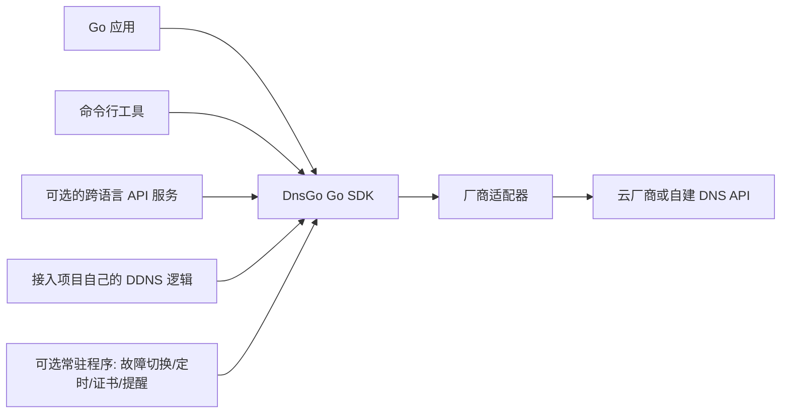

# DnsGo

DnsGo 是一个可复用的 **Go 云 DNS 接入库**：Go 项目引入它后，可以通过一致的模型管理不同厂商的域名和解析记录，并按需使用故障切换、定时变更和证书能力。Go 项目可以调用 DnsGo 的 DNS 接口实现自己的 DDNS 逻辑。

> **当前版本：`v0.1.1`（预发布）。** DnsGo 提供 22 家 DNS、8 类证书服务、50 类部署目标及可选常驻程序。阿里云 DNS 已通过两组真实账号的基础和扩展操作验证；其他厂商、CA、部署目标与使用方生产集成仍按各自证据标注。范围、修正与真实验证结果见[适配器验证记录](docs/ADAPTER-COVERAGE.md)和[实施状态](docs/IMPLEMENTATION.md)。彩虹 DNS 保存在 `reference/dnsmgr/` Git 子模块中，仅供参考并跟随官方上游更新。

## 项目定位

SDK 在这里指可被 Go 程序直接导入的代码包。面板、命令行工具或其他服务可在自己的权限和任务系统内调用 DnsGo 的厂商适配器。核心 SDK 不绑定网页、数据库或部署环境。

DnsGo 面向**云厂商及自建 DNS 平台的管理 API**，负责域名和记录管理；不提供权威 DNS 服务器或递归解析器。首版供 Go 项目直接导入；面向非 Go 项目的独立 HTTP 服务安排在后续版本。

## 目标与边界

| 层次 | 目标能力 | 边界 |
| --- | --- | --- |
| 基础 SDK | 凭据验证、域名发现、记录查询与增删改、能力声明、规范化错误、操作后回读 | 不内置租户、网页、数据库、任务队列或凭据存储 |
| DDNS 接入 | 提供查询、定位、创建、修改和回读 DNS 记录的能力，供其他项目实现自己的 DDNS | DnsGo 不实现公网 IP 探测、IP 变化判断、DDNS 调度或绑定策略 |
| 首版自动化 | 按上游功能覆盖 ping/TCP/HTTP(S) 探测切换、一次性与周期性 DNS 变更、证书申请/续期/部署、域名到期提醒及已有通知渠道 | Go 项目可调用库，可选常驻程序也能运行；不内置多用户系统 |
| 首版证书适配 | 对照彩虹 DNS 当前 8 类证书服务与 50 类证书部署目标全部实现 | 每类的真实服务验证状态分别标明 |
| 常驻程序配置 | 配置文件定义任务，环境变量提供服务凭据，本机 SQLite 保存任务状态及需要持续使用的证书材料 | Go SDK 本身不要求 SQLite；接入项目可用自己的配置和存储 |
| 后续扩展 | DNS 对账及重新设计的优选 IP 等 | CF 优选 IP 不进入首版，等待用户单独重新设计 |
| 跨语言入口 | 后续提供基于 SDK 的 HTTP 服务，让非 Go 项目调用同一套能力 | 不属于首版；鉴权方式和部署形式待定 |

“接入全套 DNS 支持”指调用方能够使用**已实现且明确标注验证状态、并由当前账号允许的能力**。厂商的记录类型、TTL、解析线路、代理、启停、备注、权重、批量能力和域名管理方式可能不同。SDK 必须明确报告支持、有条件支持、不支持或待验证，不能静默忽略请求字段，也不能把适配器文件存在当作功能验收。

## 设计原则

1. **统一常用语义，保留厂商差异。** 域名、记录和错误使用公共模型；记录 ID 与 RRset、线路、代理、优先级、状态和扩展字段保留真实语义。
2. **接口按能力拆分。** 列表、记录写入、域名创建、状态切换和批量操作不强迫所有厂商实现一个超大接口。调用前可查询能力与约束。
3. **写入有明确对象和结果。** 更新、删除作用于确定的记录或记录集合；操作超时导致结果不明时，先查询厂商状态，再决定是否重试。
4. **SDK 不替业务系统作授权决定。** 租户隔离、审计、变更审批、记录所有权和工作流由使用方负责；SDK 提供实现这些策略所需的身份、回读与错误信息。
5. **DDNS 由接入项目实现。** DnsGo 提供可靠的记录读写与回读接口；公网 IP 探测、变更判断、调度和多个绑定之间的策略由调用方决定。
6. **可核对优先于空泛声明。** 每项支持状态标明彩虹 DNS 源码依据、Go 实现对照和真实厂商验证情况；尚未实测的能力不能写成已验证。
7. **证书存储由使用方决定。** Go 库返回证书、私钥和续期所需状态，不强制文件或数据库；独立常驻程序使用本机 SQLite，并限制数据库文件访问权限。

### 基础模型与 Go 契约

以下类型已经存在于 Go 模块；0.x 阶段接口仍可能随厂商语义核对调整。可编译示例和当前签名见 [SDK 接入指南](docs/SDK.md)。

- `Zone`：厂商域名 ID、规范域名、名称服务器和状态。
- `Record`：厂商记录 ID 或 RRset 标识、厂商原有的相对或完整名称、类型、一个或多个值、TTL，以及类型所需的优先级等字段。`RecordFQDN` 可计算统一完整域名。
- `Capabilities`：列出适配器的记录类型、最低 TTL、线路及各项可选能力；账号权限或套餐仍可能限制实际调用。
- `Provider`：统一域名与记录的常用读写入口；厂商不支持的方法返回 `CodeUnsupported`，厂商特有功能通过扩展接口提供。
- `Error`：保留厂商错误码和请求 ID，同时区分鉴权失败、权限不足、参数错误、冲突、限流、网络失败及结果不明。

记录的“值”不能始终假定为单个字符串：部分厂商按 RRset 操作，某些记录类型还有多个结构化字段。规范化模型须能安全完成**读取 → 修改一个目标 → 回读**，避免覆盖同名下的其他值或丢失厂商扩展属性。

## 上游依据与厂商盘点

本地初始参考快照是 `netcccyun/dnsmgr` 的 `main` 分支提交 `b4fcb182ff186ef2c650092e1c0de93e85cbada9`（2026-10-13）。子模块中的 `app/lib/DnsInterface.php` 提供既有操作清单，`app/lib/DnsHelper.php` 声明部分能力差异，`app/lib/dns/` 包含 22 个厂商或平台适配器。[上游源码盘点](docs/UPSTREAM-INVENTORY.md)列出 22 个 DNS、8 个证书服务和 50 个部署目标的入口、公共方法矩阵、证书限制及部署产品选项。这些是**首版必须覆盖的参考范围**，不是每项行为已经通过真实厂商验证的声明。

盘点时逐家记录：

| 维度 | 需要确认的内容 |
| --- | --- |
| 身份与域名 | 凭据形式、所需权限、域名发现、域名创建/移除、区域或账号作用域 |
| 记录 | 支持类型、单值/多值、ID/RRset、分页与筛选、增删改、批量写入 |
| 厂商特性 | TTL 与自动 TTL、线路、代理、状态、备注、权重、优先级、通配符与 IDN |
| 行为 | API 限流、重试提示、异步操作、错误码、最终一致性、读写权限差异 |
| 证据 | 彩虹 DNS 源码位置、Go 接口与行为对照、厂商协议依据、真实 API 回读与权威 DNS 验证状态 |

当前[上游方法矩阵](docs/UPSTREAM-INVENTORY.md)标明源码入口，Go `Capabilities()` 由适配器报告可用的公共能力，[逐项验证表](docs/ADAPTER-COVERAGE.md)单列实现与真实服务状态。真实账号验证时再为对应能力补充测试日期、账号范围和回读结果；彩虹 DNS 源码用于发现更新，厂商官方协议和真实回读负责确认当前行为。

### 跟踪彩虹 DNS 的更新

1. 监测上游发布及 `app/lib/dns/`、`app/lib/client/`、`app/lib/DnsHelper.php` 等相关变更。
2. 将变更映射到厂商、操作、记录类型和能力矩阵；记录上游提交与影响范围。
3. 根据彩虹 DNS 的功能接口与行为独立实现或调整 Go 适配器，并逐项核对方法、参数、结果和厂商差异。
4. 对涉及写入语义、签名、分页或错误处理的变化，使用测试域名完成厂商 API 回读；必要时核对权威解析。
5. 发布有版本号的 SDK 变更，再由 接入项目选择升级。

上游变更不会自动合并成可写代码。这样既能持续吸收彩虹 DNS 的维护成果，也能保持 DnsGo 的 API 与兼容性承诺。

## 使用方职责

接入已有系统时，先对照其运行行为、数据模型和厂商调用，明确原有 DNS 写入路径的切换点。

| 归属 | 内容 |
| --- | --- |
| DnsGo | DNS 厂商协议、通用记录模型、能力查询、错误分类、请求与回读；故障切换、定时、证书、提醒和通知模块及可选常驻程序 |
| 使用方 | 租户与权限、凭据加密保存、审计、数据库、Temporal 工作流、记录管理权、DDNS 的 IP 来源与实例/槽位绑定、生产切换策略 |

接入现有面板时，先保持现有行为和测试基线；切换使用 DnsGo 后，再分别确认厂商 API 记录、权威 DNS 结果和业务实际可达性。面板中的生产执行权不能因为换了 SDK 就自动转移。

## 首个公开版本的交付与验收

下表所有首版项目一并完成后才发布首个功能版本；表格顺序是核对分工，不代表分批发布。

| 范围 | 可检查的交付物 |
| --- | --- |
| 上游与仓库 | 独立 Git 仓库、只供参考且可跟随上游更新的子模块、许可与来源记录、22/8/50 入口及方法清单 |
| DNS SDK | 可导入的 Go 模块、公共契约、全部 22 个厂商适配器、使用示例、逐厂商源码功能对照与编译检查；缺少真实账号验证的厂商明确标注“尚未实测” |
| DDNS 接入 | 给接入项目提供可用于 DDNS 的记录定位、读写和回读接口及示例；DDNS 的 IP 来源、判断和调度由接入项目实现 |
| 自动化与通知 | 故障切换、定时 DNS 变更、证书申请/续期/部署、域名到期提醒及上游已有通知渠道；Go 库与可选常驻程序都能运行，对照彩虹 DNS 的功能入口与行为 |
| 证书适配 | 覆盖参考源码中的 8 类证书服务和 50 类部署目标；逐项标明源码对照与真实验证状态 |
| 常驻程序 | 运行故障切换、定时、证书和提醒任务；无管理网页，使用配置文件、环境变量和 SQLite，可独立安装运行 |
| 集成准备 | 给 Go 项目提供可导入模块、字段映射和接入示例；实际面板切换需在面板仓库按其租户、凭据、RRset 所有权和审计契约单独验收 |

超出当前上游范围的厂商、DNS 对账、跨语言 HTTP 服务和重新设计的优选 IP 属于后续版本。

现阶段不安排模拟厂商 API 测试；验收首先对照彩虹 DNS 的功能接口与行为，并完成 Go 编译和静态检查。22 家适配器可以按源码实现后发布；未经真实厂商调用的能力逐家标为“按源码实现，尚未实测”。验证结果仍须分开记录：源码对照、厂商真实 API 调用、权威 DNS 查询、使用方集成。测试中不得使用生产域名做破坏性写入；凭据不进入仓库、日志或示例。构建产物、安装包和运行数据应加入 `.gitignore`。

## 当前如何使用

Go 模块路径为 `github.com/rainchen537/dnsgo`。Go 项目可执行 `go get github.com/rainchen537/dnsgo@v0.1.1`，再导入根包及 `providers`、`cert`、`deploy`、`automation`、`notify` 等子包；调用和数据语义见[SDK 接入指南](docs/SDK.md)，可选 `dnsgo-agent` 的配置、构建和恢复步骤见[常驻程序指南](docs/AGENT.md)。PHP 参考源码位于 `reference/dnsmgr/`，其中的 `composer.json`、`app/`、`config/` 和 `public/` 均属于彩虹 DNS；其安装方法见[上游 README](reference/dnsmgr/README.md)。厂商真实行为尚未逐家验证，生产切换前应在自己的账号和测试域名上回读。

公开仓库地址为 [Rainchen537/dnsgo](https://github.com/Rainchen537/dnsgo)。参考子模块的 `origin` 指向彩虹 DNS 官方仓库；在子目录从上游快进更新，核对变化后更新根仓库记录的子模块提交。参考子目录不维护单独的功能分支或本地改动。克隆根仓库后，可运行 `git submodule update --init --recursive` 获取参考源码。[只读 DNS 接入示例](examples/dns_read/main.go)可作为接入项目的最小起点。

## 已确定与待确定

**已确定**

- 名称：**DnsGo**；主要实现语言：**Go**。
- 公开仓库为 `https://github.com/Rainchen537/dnsgo`；Go 模块路径为 `github.com/rainchen537/dnsgo`，最低版本见 `go.mod`（当前 Go 1.24）。
- 产品目标：独立、可复用的云 DNS 接入能力，供其他项目实现 DDNS 等业务逻辑，并提供选定的 DNS 自动化模块。
- 彩虹 DNS 是持续跟踪的参考上游；Go 项目可直接导入 SDK。
- 仓库根目录归 DnsGo 使用；彩虹 DNS 源码放入仅供参考的子目录，不作为 DnsGo 的运行依赖。
- 彩虹 DNS 参考子目录直接跟随官方上游更新，不在其中进行 DnsGo 开发。
- DnsGo 首版目标是实现当前参考快照中的全部 22 个厂商或平台适配器；每家的真实验证状态分别标明。
- 首版提供 Go SDK 和可选常驻程序；跨语言 HTTP 服务放在后续版本。
- DnsGo 不实现 DDNS 引擎；接入项目自行处理 IP 探测、变化判断和调度，并使用 DnsGo 的 DNS 记录接口。
- DnsGo 不实现管理网页或多用户系统；接入项目使用自己的前端、用户、租户和权限体系。
- 故障切换、定时 DNS 变更和证书功能进入首版；优选 IP 暂缓，按用户后续方案重新实现。
- 首版证书功能覆盖申请、自动续期和部署三个环节，并覆盖当前参考源码的 8 类证书服务和 50 类部署目标。
- 可选常驻程序首版运行故障切换、定时变更、证书续期与部署、域名到期提醒和通知；Go 项目仍可只调用库。
- 常驻程序通过配置文件定义任务、通过环境变量获取服务凭据，并用本机 SQLite 保存任务、执行状态及需要持续使用的证书材料；数据库文件限制为当前运行用户访问。
- Go 库不强制证书和私钥的持久化方式；接入项目接收结果后按自身架构保存。
- 现阶段不安排模拟厂商 API 测试；优先逐项对照彩虹 DNS 的功能接口和行为。
- 22 家适配器可在缺少真实厂商账号的情况下按源码实现后发布，逐家标注“尚未实测”。
- 厂商支持以能力与验证证据表达，不以文件数量或统一接口名称代替验收。

**后续仍需确定**

- 跨语言 HTTP 服务的鉴权、部署形式及兼容性承诺。
- 优选 IP 的重新设计方案；首版不包含现有 CF 优选实现。
- 0.x 阶段的长期兼容性策略，以及真实厂商验证后可能需要的接口调整。
- 参考子模块 `LICENSE` 与 `composer.json` 的许可标注差异；来源记录见[第三方来源与署名](THIRD_PARTY_NOTICES.md)。

## 开源与许可

DnsGo 根仓库中的原创内容采用 [MIT 许可证](LICENSE)。`reference/dnsmgr/` 是独立的上游 Git 子模块，其源码、署名和许可由原项目维护；DnsGo 的许可证不替它重新授权。上游仓库 `LICENSE` 与 `composer.json` 的许可标注差异及署名记录见[第三方来源与署名](THIRD_PARTY_NOTICES.md)。

## 文档分工与续写

本 README 负责 DnsGo 的项目定位、当前可用状态、模块边界、集成关系和路线图。[上游源码盘点](docs/UPSTREAM-INVENTORY.md)只记录参考源码入口与静态标记，由 `scripts/upstream_inventory.py` 生成；[配置字段索引](docs/CONFIG-KEYS.md)只列 Go 适配器读取的字面量配置键，由 `scripts/config_keys.py` 生成；[实施与验证状态](docs/IMPLEMENTATION.md)记录 Go 总体进度；[适配器逐项验证记录](docs/ADAPTER-COVERAGE.md)记录每家源码对照和真实服务证据；[SDK 接入指南](docs/SDK.md)维护包的调用和数据语义；[常驻程序指南](docs/AGENT.md)维护配置、命令和恢复流程；[第三方来源与署名](THIRD_PARTY_NOTICES.md)记录参考项目和直接引入内容的许可通知。`reference/dnsmgr/README.md` 是上游 PHP 项目的安装说明，由其独立 Git 仓库维护。未来的决策记录应放在专门文档中，并从这里链接；同一事实只在一处维护。

每次续写都应区分**目标、已实现、已验证和待决定**，标出依据及日期。新增厂商时先更新能力与证据，再更新支持声明；新增可运行命令时同时补上安装和最小使用示例。文档中的示例不能包含真实凭据、生产域名或不可运行的占位命令。
